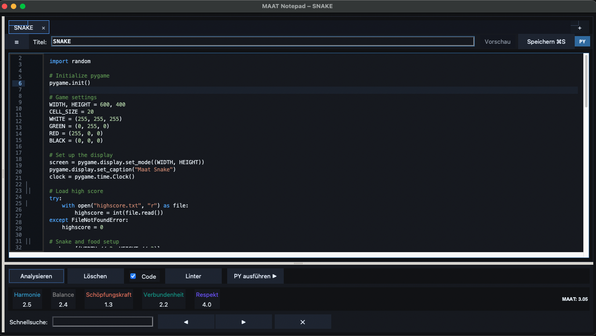

# MAAT Notepad

Ein editororientiertes Notepad in Python/Tkinter fuer macOS mit Fokus auf Schreiben, Code, Markdown, TeX und lokale Ausfuehrung.

## Funktionsliste

### Editor und Bedienung

- dunkles, editorartiges UI
- Tabs fuer mehrere offene Notizen und Dateien
- Session Restore fuer offene Tabs beim Neustart
- linke Navigationsleiste ein- und ausklappbar
- konfigurierbare Editor-Schriftart und Schriftgroesse
- Zeilennummern und aktive Zeilenmarkierung
- Rechtsklick-/Kontextmenues fuer Editor und Eingabefelder
- Suche, Ersetzen und Schnellsuche
- sortierbare Notizenliste

### Notizen und Dateitypen

- interne Notizen mit Speicherung und MAAT-Auswertung
- externe Dateien direkt oeffnen und wieder zurueckspeichern
- Unterstuetzung fuer:
  `txt`, `md`, `markdown`, `py`, `tex`, `sh`, `command`, `json`, `yaml`, `yml`,
  `html`, `htm`, `css`, `php`, `rs`, `js`, `mjs`, `cjs`, `java`, `bat`, `cmd`, `ps1`

### Code- und Dokumentfunktionen

- Syntax-Highlighting fuer alle unterstuetzten Code-/Textformate
- Markdown-Vorschau im Editor
- HTML-Vorschau
- TeX-PDF-Vorschau direkt im Notepad
- TeX-Dateianhaenge wie Bilder und Input-Dateien direkt aus dem Programm einfuegen
- einfacher Linter fuer Python
- Shell-, Command-, Python- und TeX-Ausfuehrung direkt aus dem Editor
- automatische Python-/venv-Erkennung fuer `PY ausfuehren`
- venv-Auswahl, venv im Terminal oeffnen und Pfad im Terminal oeffnen

### MAAT-Funktionen

- automatische MAAT-Bewertung fuer Notizen
- Anzeige der Einzelwerte fuer Harmonie, Balance, Schoepfungskraft, Verbundenheit und Respekt
- Sortierung nach MAAT, Titel, Erstellung und Aenderung

### macOS- und App-Funktionen

- py2app-Build fuer eine native `.app`
- getrennte Build-Skripte fuer Apple Silicon (`arm64`) und Intel (`x86_64`)
- Dateiformat-Verknuepfungen fuer macOS
- App-Icon-Unterstuetzung via `icon.icns`

## Projektstruktur

```text
.
|- maat_notepad.py
|- setup.py
|- build_arm_app.command
|- build_intel_app.command
|- icon.icns
|- requirements.txt
`- images/
```

## Schnellstart

```bash
python3 -m pip install -r requirements.txt
python3 maat_notepad.py
```

## Systemvoraussetzungen

### Python-Abhaengigkeiten

Die Python-Pakete fuer Vorschau, Linter und App-Build stehen in [requirements.txt](requirements.txt):

```bash
python3 -m pip install -r requirements.txt
```

Enthalten sind insbesondere:

- `Pillow` fuer die TeX-/PDF-Vorschau
- `pyobjc-framework-Cocoa` und `pyobjc-framework-WebKit` fuer die native macOS-HTML/WebView-Vorschau
- `flake8` fuer den Python-Linter

### Externe System-Tools

Fuer einige Funktionen werden zusaetzlich macOS-/TeX-Tools benoetigt, die nicht ueber `pip` kommen:

- TeX-Build: `latexmk`, `pdflatex`, `xelatex` oder `lualatex`
- PDF-Preview-Fallbacks: `gs` oder `magick`
- macOS-intern vorhanden: `sips`, `qlmanage`

Empfehlung fuer TeX unter macOS:

- installiere `MacTeX`, wenn TeX-Build und PDF-Vorschau vollstaendig funktionieren sollen

Wichtig:

- ohne TeX-Distribution funktioniert der `.tex`-Build nicht
- ohne `gs` oder `magick` koennen manche PDF-Vorschau-Fallbacks fehlen
- die HTML-WebView-Vorschau auf macOS braucht die PyObjC-Pakete aus `requirements.txt`

## App erzeugen unter macOS

### Voraussetzungen

- macOS
- ein normales Python von Python.org oder Homebrew
- empfohlen: Python `3.12`, `3.11` oder `3.10`
- nicht empfohlen fuer py2app hier: System-/CLT-Python und moeglichst auch nicht `3.13`

### Build fuer Apple Silicon

```bash
chmod +x build_arm_app.command
./build_arm_app.command
```

### Build fuer Intel

```bash
chmod +x build_intel_app.command
./build_intel_app.command
```

### Ergebnis

Nach erfolgreichem Build liegt die App hier:

```text
dist/MAAT Notepad.app
```

### Manueller py2app-Build

Wenn du lieber ohne die Helper-Skripte bauen willst:

```bash
python3 -m venv .build_venv_manual
source .build_venv_manual/bin/activate
python -m pip install --upgrade pip setuptools wheel py2app pillow
python setup.py py2app
```

### Hinweise zum Build

- `build_arm_app.command` erstellt eine `arm64`-App.
- `build_intel_app.command` erstellt eine `x86_64`-App.
- auf Apple-Silicon-Macs nutzt das Intel-Skript automatisch `arch -x86_64`, wenn noetig
- beide Skripte bevorzugen bewusst Python `3.12/3.11/3.10`
- `icon.icns` wird automatisch ins App-Bundle eingebunden

## Screenshots

### Codeansicht



### Notizenansicht


### TeX-Ansicht


